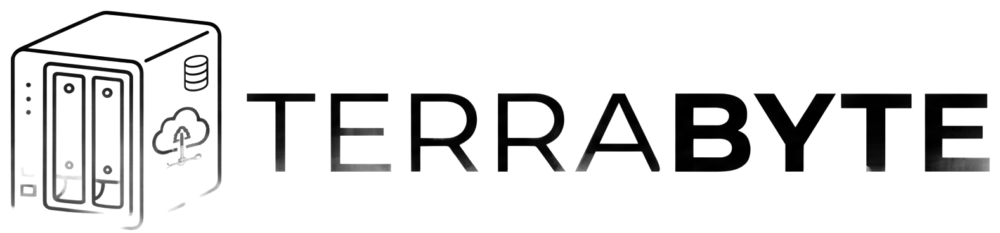

# TERRABYTE

<picture>
  <source media="(prefers-color-scheme: dark)" srcset="simple/assets/Logo.png">
  
</picture>

## Descripción

Este es un proyecto de programación con enfoque **frontend**, basado en el desarrollo de una tienda virtual de productos de hardware para computadoras, con especial atención a los equipos **NAS** y al almacenamiento.

El objetivo principal del proyecto es desarrollar una interfaz **rápida, intuitiva y fácil de utilizar**, donde el usuario pueda recorrer el catálogo, consultar la información de los productos, armar su propio NAS y guardar en el carrito aquellos que sean de su interés.

Desde el frontend se priorizó la **experiencia de usuario**, la organización visual de los productos, la navegación entre las distintas secciones y la adaptación de la página a diferentes tamaños de pantalla, con modo claro y modo oscuro.

La tienda existe en **dos versiones**, que funcionan de forma independiente:

| Carpeta | Qué es |
| ------- | ------ |
| `react/` | La versión principal, hecha con **React**. Es la más completa. |
| `simple/` | La versión original, hecha con **HTML, CSS y JavaScript puro**, sin instalar nada. Se conserva como referencia. |

## Qué se puede hacer en la tienda

- Ver la página de inicio con los productos destacados.
- Buscar productos y filtrarlos por categoría.
- Ver el detalle de un producto y agregarlo al carrito.
- Armar un NAS a medida, eligiendo los componentes paso a paso.
- Revisar el carrito: cambiar cantidades, quitar productos y simular la compra.
- Crear una cuenta, iniciar sesión y cerrar sesión. En la versión React, para ver el carrito hay que haber iniciado sesión.
- Cambiar entre modo claro y modo oscuro.
- Leer la información de la empresa y las páginas legales (privacidad, términos, reembolsos y mapa del sitio).

---

## Guía de Desarrollo

La guía de desarrollo tiene como objetivo facilitar la incorporación de nuevos integrantes al equipo y establecer una metodología de trabajo común.

### Clonar el repositorio

Para comenzar a trabajar en el proyecto, se deberá clonar el repositorio y acceder a la carpeta correspondiente:

```bash
git clone https://github.com/franrapetti/Terabyte_hardware.git
cd Terabyte_hardware
```

### Probar el proyecto

**Versión React.** Requiere tener instalado [Node.js](https://nodejs.org) (versión 20.19 o superior):

```bash
cd react
npm ci
npm run dev
```

La terminal muestra la dirección donde se abre el sitio, normalmente `http://localhost:5173`.

**Versión simple.** No hay nada que instalar: es HTML, CSS y JavaScript puro. Se prueba desde un servidor local:

```bash
cd simple
python3 -m http.server 8000
```

Después, abrir `http://localhost:8000/html/home.html`. También sirve la extensión Live Server de VS Code.

En las dos versiones conviene abrir el sitio desde `localhost`. Abrirlo directamente como archivo, o desde la dirección IP de la red (por ejemplo, desde un celular), puede impedir que funcione el inicio de sesión.

### Flujo de trabajo

Para realizar cambios en el proyecto se deberá:

1. Actualizar la rama principal antes de comenzar a trabajar.
2. Crear una rama nueva para la funcionalidad o modificación. El nombre va en minúscula y con un prefijo, por ejemplo `feat/productos` o `fix/carrito`.
3. Realizar los cambios correspondientes.
4. Probar que los cambios funcionen correctamente. En la versión React, ejecutar `npm run lint` y `npm run build` y comprobar que no den errores.
5. Revisar los cambios con `git diff` antes de hacer el commit: algunos editores reformatean archivos completos al guardar.
6. Realizar el commit siguiendo la estructura establecida.
7. Subir la rama al repositorio.
8. Crear una Pull Request.
9. La Pull Request deberá ser revisada y aprobada por otro integrante del equipo antes de incorporarse a la rama principal.

### Estructura de los commits

Los commits deberán utilizar una estructura clara que permita identificar rápidamente qué tipo de modificación se realizó.

Ejemplos:

| Tipo     | Descripción                  |
| -------- | ---------------------------- |
| feat     | Agregar tarjeta de producto  |
| fix      | Corregir diseño del carrito  |
| style    | Ajustar estilos del catálogo |
| refactor | Reorganizar componentes      |
| docs     | Actualizar documentación     |

### Pull Requests

Cada Pull Request deberá indicar claramente:

- Qué funcionalidad o modificación se realizó.
- Qué archivos o componentes fueron modificados.
- Si existen aspectos que requieren especial atención durante la revisión.
- El nombre del integrante que realizó la modificación.

Cada Pull Request deberá contar con un **revisor diferente al desarrollador que realizó los cambios**. El revisor deberá comprobar que la funcionalidad cumpla con lo solicitado y que no introduzca errores en otras partes del proyecto antes de aprobarla.

---

## Estructura del repositorio

```text
Terabyte_hardware/
├── README.md
├── simple/    # Versión HTML, CSS y JavaScript (con su propio README)
└── react/     # Versión React (con su propio README)
```

Cada carpeta tiene sus propios recursos y se ejecuta por separado. Para más detalles, ver el [README de React](react/README.md) y el [README de la versión simple](simple/README.md).

## Alcance y limitaciones

- Es un proyecto de práctica y **no tiene servidor**: las cuentas, el carrito y el tema se guardan en el navegador de cada persona y no se comparten entre dispositivos.
- La compra es **simulada**: no se cobra ni se envía ningún pedido.
- Las cuentas son una demostración y **no reemplazan un sistema de seguridad real**.
- Si dos personas usan el mismo navegador, comparten el carrito.
- Hace falta conexión a Internet para cargar la tipografía.
