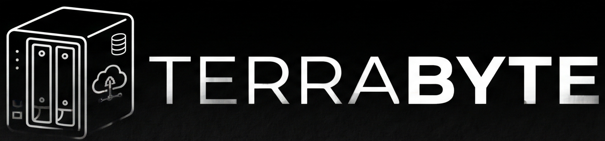

# TerraByte — entrega React



Esta entrega migra la tienda original a React, con componentes reutilizables,
navegación con React Router y estilos con TailwindCSS. Vite ejecuta el entorno
de desarrollo y genera la compilación de producción.

La entrega anterior se conserva en [simple](../simple/README.md).
La aplicación React se encuentra en [`TerraByte/`](TerraByte/README.md).

## Instalar y ejecutar

Con Node.js y npm instalados, desde esta carpeta:

```bash
cd TerraByte
npm ci
npm run dev
```

Abrir la dirección indicada por Vite, normalmente
[http://localhost:5173/](http://localhost:5173/).
Desde la raíz del repositorio, la carpeta de trabajo es `react/TerraByte/`.

## Estructura de la aplicación

```text
TerraByte/
├── index.html
├── package.json
├── public/
├── src/
│   ├── assets/          # Recursos propios de esta entrega
│   ├── components/      # Header, Footer, tarjetas, carruseles, modales y formularios
│   ├── data/            # Catálogo y opciones del configurador NAS
│   ├── functions/       # Auth, Theme, CartFuncion y lógica compartida
│   ├── pages/           # Páginas de tienda, cuenta e información
│   ├── App.jsx          # Rutas de la aplicación
│   └── main.jsx         # Inicio de React y del tema
└── tests/               # Pruebas de navegador con Playwright
```

## Funcionalidades y rutas

| Sección | Rutas |
| --- | --- |
| Tienda | `/`, `/products`, `/services`, `/cart` |
| Cuenta | `/login`, `/register` |
| Empresa e información | `/aboutus`, `/sitemap`, `/terms`, `/refunds`, `/legal`, `/privacy` |

El catálogo combina búsqueda y categorías. El configurador NAS conserva las
selecciones entre pasos y calcula el total. El carrito permite modificar
cantidades, quitar productos, vaciar y confirmar una compra simulada.
La sesión y los temas se sincronizan entre pestañas.

También se aceptan las direcciones anteriores con `.html`, que redirigen a
las rutas de React. En producción, el alojamiento debe servir `index.html`
para las rutas de la aplicación al abrirlas directamente o recargar.

## Comprobar y compilar

Ejecutar desde `react/TerraByte/`:

```bash
npm run lint
npm run build
npm run preview
```

La compilación se genera en `TerraByte/dist/`. Para las pruebas de navegador:

```bash
npx playwright install chromium
npm run test:e2e
```

Las pruebas arrancan Vite en `127.0.0.1:4175` y comprueban carrito,
autenticación, temas, navegación, modales, carruseles y diseño adaptable.

## Datos y recursos independientes

Las imágenes se importan desde `TerraByte/src/assets/`, una copia independiente
de los recursos originales. La aplicación puede ejecutarse y compilarse sin
la carpeta `simple/`.

Las cuentas, la sesión, el carrito y el tema se guardan en `localStorage`.
La autenticación es local al navegador y requiere localhost o HTTPS para
Web Crypto. La compra sigue siendo una simulación del prototipo frontend.

Consultar el [README de la aplicación](TerraByte/README.md) para los detalles
de implementación y el [README general](../README.md) para las pautas del equipo.
